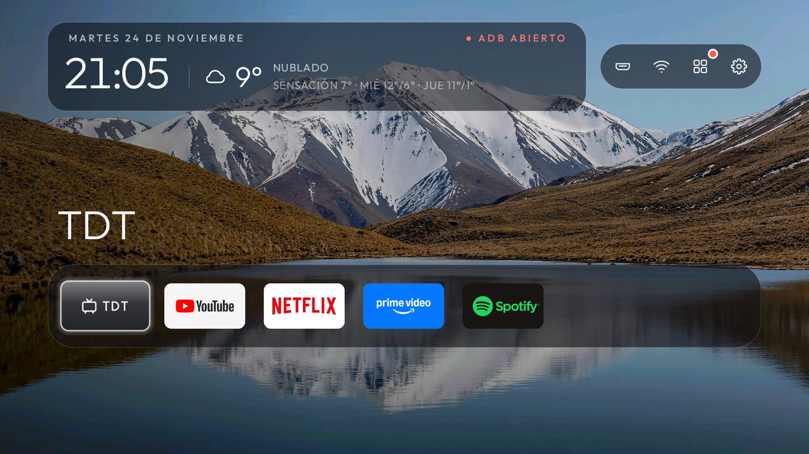
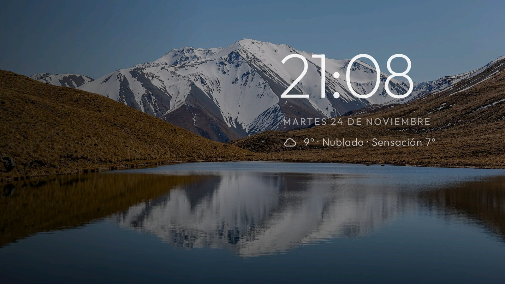
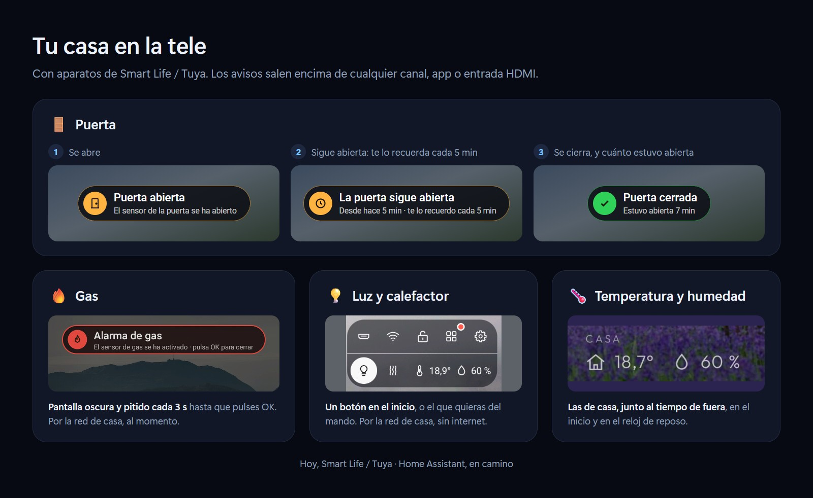
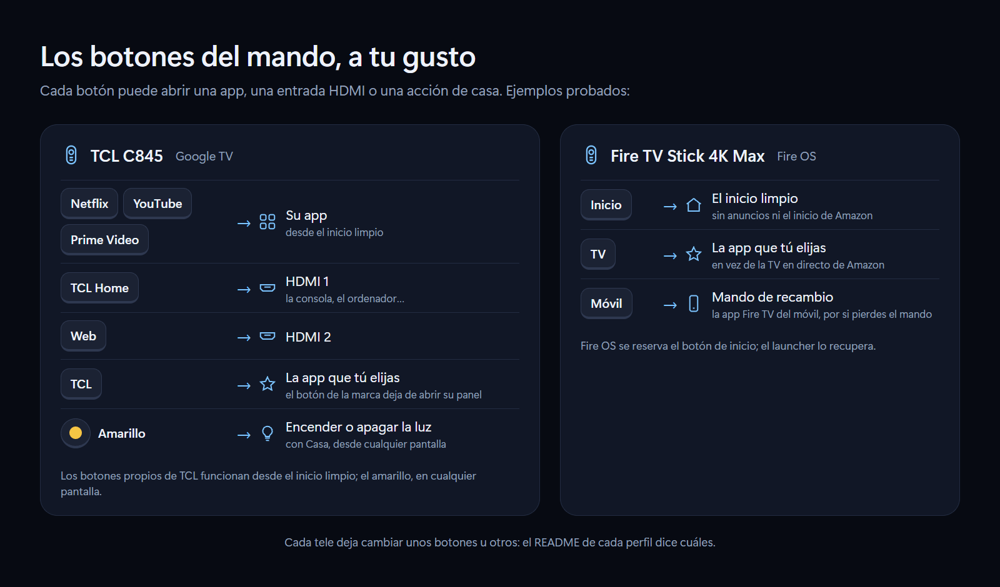

<div align="center">

# Tuned TV

**Cualquier tele, a punto.**

Quita anuncios, apps de sobra y rastreo de tu smart TV o tu stick, por la red de casa.
Mide la diferencia y deshazlo todo cuando quieras. Sin root y sin desinstalar nada.

[](https://github.com/ignaciopd3/tuned-tv/actions/workflows/tests.yml)
[](LICENSE)


[English](README.md) · **Español**

</div>

---

## Cómo queda

<p align="center">
  
  
</p>

Capturas reales de una TCL C845 con el perfil de ejemplo: tus apps en tu orden, la hora y el tiempo, y ni una sugerencia
ni un anuncio. Tras unos minutos sin tocar el mando sale el reloj de la derecha, y los fondos van cambiando. El aviso
rojo «ADB abierto» solo sale mientras la depuración está activada.

<sub>Fondo: «Lake Mystery, Canterbury, New Zealand» de Michal Klajban, CC BY-SA 4.0 (ver
[launcher/CREDITS.md](launcher/CREDITS.md)).</sub>

## Por qué

Las smart TV traen apps que nadie ha pedido. Muchas, además, informan de lo que ves, también de lo que entra por HDMI
(ACR), y ponen anuncios en un inicio que ya has pagado. Todo eso gasta memoria y CPU en un chip que ya era lento.
Tuned TV lo apaga con las herramientas de desarrollo de la propia tele, paso a paso y revisando cada uno.

## Qué hace

- **Quita lo que sobra sin desinstalar.** Los paquetes se deshabilitan, nunca se borran, después de sacar una foto de
  la tele. Cada ejecución se puede deshacer. Lo que la tele necesita (inicios, teclados, wifi, HDMI, DRM, la app de
  la tele) está protegido y el motor se niega a tocarlo.
- **Ajustes de privacidad.** Seguimiento publicitario limitado, informes de uso apagados y ACR apagado donde se puede.
  Si quieres, un DNS privado que bloquea anuncios y rastreadores en toda la tele.
- **Más rápida, y medido.** `medir` anota CPU, memoria, intercambio y los procesos que más gastan en reposo, antes y
  después, para ver qué ha dado cada cambio.
- **Un inicio limpio** (opcional), hecho a partir del launcher de [cleanyourtv](https://github.com/Gathin23/cleanyourtv)
  con los parches de Tuned TV: sin sugerencias ni anuncios, tus apps en tu orden, reloj, tiempo y botones del mando que
  hacen lo que quieres. En Fire TV se queda incluso con el botón de inicio, que Fire OS normalmente se reserva.
- **Canales de la TDT en orden.** Sintoniza y ordena los canales a tu gusto, con la mejor versión de cada uno en su
  número: la UHD si tu tele la admite, la HD si no. Tú decides. [Cómo](docs/guides/channels.es.md).
- **Tu casa en la tele** (opcional): avisos de puerta y gas encima de lo que veas, y luz y calefactor a un botón, con
  Smart Life / Tuya. [Ver abajo](#tu-casa-en-la-tele).
- **Perfiles por modelo.** Cada modelo de tele tiene su carpeta con sus listas, ajustes y notas, para que el siguiente
  con ese modelo empiece desde algo probado. [Añade el tuyo](CONTRIBUTING.es.md).

## Tu casa en la tele

<p align="center">
  
</p>

Con el complemento **Casa** y aparatos de Smart Life / Tuya, la tele avisa de la puerta y del gas encima de lo que estés
viendo, y enciende la luz o el calefactor desde el inicio o con un botón del mando. Paso a paso, en la
[guía de domótica](docs/guides/home-automation.es.md). Home Assistant, en camino.

> [!NOTE]
> **Hacen falta aparatos inteligentes.** Cada función va con el suyo, compatible con Smart Life / Tuya: un enchufe wifi
> para la luz, otro para el calefactor, un sensor de puerta, un detector de gas y un sensor de temperatura y humedad.
> Pon solo los que quieras. La [guía](docs/guides/home-automation.es.md#qué-necesitas) dice qué buscar.

<sub>Los avisos de la puerta están dibujados con los colores y medidas del complemento; el gas, el panel y el reloj son
recortes de capturas reales (fondos CC BY-SA, ver [launcher/CREDITS.md](launcher/CREDITS.md)).</sub>

## Los botones del mando

<p align="center">
  
</p>

Se eligen en el `launcher/config.json` de cada perfil (`app_keys` y `redirect_apps`) y, donde el firmware los lee de
los ajustes, en `remap.conf`. El README de cada perfil dice qué botones se pueden cambiar en ese modelo.

## Sistemas

| Sistema | Estado | Guía |
|---|---|---|
| **Android TV / Google TV** (TCL, Sony, Xiaomi, Philips, Hisense Android, Chromecast, Shield…) | ✅ Funciona, probado | [android-tv](docs/guides/android-tv.es.md) |
| **Fire OS** (Fire TV Stick, Cube, teles Fire TV Edition) | ✅ Funciona, probado | [fire-tv](docs/guides/fire-tv.es.md) |
| **LG webOS** | 📘 Guía lista; soporte en camino | [lg-webos](docs/guides/lg-webos.es.md) |
| **Samsung Tizen** | 📘 Guía lista; soporte en camino | [samsung-tizen](docs/guides/samsung-tizen.es.md) |

Roku, Hisense VIDAA y lo que necesite root quedan fuera.

### Modelos probados

| Modelo | Sistema | Perfil |
|---|---|---|
| TCL C845 (G05, MediaTek MT9615, EU) | Google TV 11 | [`profiles/tcl-c845-mt9615`](profiles/tcl-c845-mt9615/README.es.md) |
| Amazon Fire TV Stick 4K Max (1.ª gen., AFTKA) | Fire OS 7.7 | [`profiles/fire-tv-4k-max-aftka`](profiles/fire-tv-4k-max-aftka/README.es.md) |

¿No está tu modelo? Puede funcionar igual: parte del perfil más parecido o de `profiles/_template`, y compártelo
cuando vaya bien.

## Inicio rápido

**Necesitas:** [uv](https://docs.astral.sh/uv/) (trae su propio Python), el
[`adb`](https://developer.android.com/tools/releases/platform-tools) de Android en el PATH (o su ruta en `ADB`) y la
tele en la misma red que el ordenador.

```bash
git clone https://github.com/ignaciopd3/tuned-tv.git
cd tuned-tv
uv sync
```

1. **Activa la depuración en la tele** con la [guía de tu sistema](#sistemas). La primera vez que se conecte el
   ordenador, acepta el aviso «¿Permitir depuración?».
2. **Dile a la herramienta cuál es la tele:**
   ```bash
   export TV_SERIAL=<ip-de-la-tele>:5555      # Windows PowerShell: $env:TV_SERIAL = "<ip-de-la-tele>:5555"
   ```
3. **Mide primero**, con la tele quieta en su inicio:
   ```bash
   uv run run.py medir --perfil <perfil>
   ```
4. **Mira el plan.** Todavía no cambia nada:
   ```bash
   uv run run.py motor --profile <perfil> --action all --dry-run
   ```
5. **Aplícalo** si estás de acuerdo con el plan, y vuelve a medir:
   ```bash
   uv run run.py motor --profile <perfil> --action all
   uv run run.py medir --perfil <perfil>
   ```
6. **Deshazlo** cuando quieras:
   ```bash
   uv run run.py motor --profile <perfil> --action rollback --all
   ```

Acciones: `audit` (solo lectura), `debloat`, `optimize` (ajustes, permisos de apps y niveles de registro), `remap`
(botones del mando), `all` y `rollback`. Con `--include-caution` entran los paquetes opcionales de `packages.caution`.

**Al terminar, vuelve a apagar la depuración** (Opciones para desarrolladores → depuración USB, de red o ADB). El ADB
por red va sin cifrar, y en algunos firmwares cualquiera de tu red tiene una terminal en la tele. Los cambios y el
inicio limpio siguen funcionando sin ella.

## El launcher

`uv run run.py launcher --perfil <perfil>` compila el inicio limpio y lo instala, con sus complementos y el tema del
perfil (`profiles/<perfil>/launcher/config.json`). Usa caché, así que solo recompila si cambian los parches, y espera
a que el inicio de la tele esté delante para instalar.

Para compilarlo necesitas además:

- **JDK 17** (`JAVA_HOME`) y el **Android SDK** con la plataforma 34 (`ANDROID_HOME`);
- **un clon de cleanyourtv** junto a este repo (`../cleanyourtv`, o su ruta en `CYT_DIR`), con su entorno de
  herramientas: `python3 -m venv tools/venv && tools/venv/bin/pip install -r tools/requirements.txt` dentro de ese
  clon;
- **una clave de firma estable** (por defecto `~/.android/debug.keystore`). Android solo actualiza una app firmada con
  la misma clave, así que guarda una copia.

Los parches están en [`launcher/patches/`](launcher/patches/), sobre la versión de cleanyourtv que dice
[`launcher/patches/BASE`](launcher/patches/BASE). [Cómo funciona](docs/how-it-works.es.md#el-launcher) explica cada
pieza.

## Seguridad

- **Sin root y sin escribir en `/system`.** Un restablecimiento de fábrica deja siempre la tele como venía.
- **Deshabilitar, no desinstalar.** La rara excepción, un paquete persistente que arranca aunque esté deshabilitado,
  se quita solo para tu usuario (`pm uninstall -k --user 0`) y vuelve con `cmd package install-existing`.
- **Foto antes de cada cambio, comprobación después y deshacer para cada ejecución.**
- **Paquetes protegidos** ([`lib/protected.list`](lib/protected.list)): ningún perfil puede tocarlos.
- **Primero en simulación.** El plan se enseña y se guarda antes de hacer nada.

Deshabilitar paquetes puede romper funciones que uses (con el asistente se va la búsqueda por voz, por ejemplo). Cada
perfil explica lo que cuesta cada línea. Léelo antes de aplicar, y deja la depuración apagada cuando no la uses.

## Preguntas

<details>
<summary><b>Una actualización lo ha devuelto todo.</b></summary>

Actualizar una app del sistema la vuelve a activar. Lanza el mismo perfil con `--dry-run`: si el plan no sale vacío,
aplícalo. En Fire TV, el actualizador de Amazon lo hace cada pocas semanas.
</details>

<details>
<summary><b>¿Pierdo la garantía?</b></summary>

Solo usa los ajustes de desarrollo que ofrece la propia tele, y un restablecimiento de fábrica quita todos los cambios.
Las condiciones de garantía cambian según la marca y el país; si te importa, revisa las tuyas.
</details>

<details>
<summary><b>¿Puedo quitarlo todo?</b></summary>

No. Algunos paquetes parecen inútiles pero llevan el cambio de entradas, el DRM o el mando. Los perfiles solo
incluyen lo que se deshabilitó en ese modelo sin efectos secundarios, y lo arriesgado espera en `packages.caution`.
</details>

<details>
<summary><b>¿Por qué las órdenes se llaman «medir» y «motor»?</b></summary>

El proyecto empezó en español. El código y sus comentarios siguen en español; la documentación está en los dos
idiomas.
</details>

## Colaborar

Lo que más ayuda es un **perfil para un modelo** que todavía no esté. [CONTRIBUTING.es.md](CONTRIBUTING.es.md) te
lleva paso a paso: identificar el modelo, partir de la plantilla, simular, aplicar, medir y escribir sus notas. Los
fallos y las ideas van en [issues](https://github.com/ignaciopd3/tuned-tv/issues/new/choose).

## Créditos

Tuned TV se apoya en el trabajo de
[cleanyourtv](https://github.com/Gathin23/cleanyourtv) (listas de Android TV y el launcher),
[dumbtv](https://github.com/humblemuzzu/dumbtv) (listas de Fire OS y la toma del botón de inicio) y
[free-my-tv](https://github.com/simbasjungles/free-my-tv) (LG webOS y Samsung Tizen).
Los detalles y las licencias están en [CREDITS.md](CREDITS.md).

## Licencia

[MIT](LICENSE). Algunos datos e imágenes tienen su propia licencia (CC BY-SA 4.0 en el catálogo de dumbtv, CC BY y
CC BY-SA en los fondos): ver [CREDITS.md](CREDITS.md).
