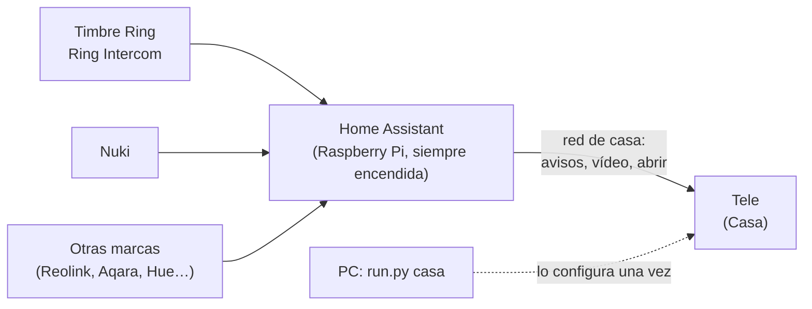

# Home Assistant: el timbre, el portal, la puerta y toda la casa en la tele

[English](home-assistant.md) · [Volver al README](../../README.md) · [Smart Life sin Home Assistant](home-automation.es.md)

El complemento **Casa** puede tomarlo todo de [Home Assistant](https://www.home-assistant.io): cualquier marca que
conozca Home Assistant llega a la tele sin apps, cuentas ni asistentes de voz en la propia tele.

| | Qué hace |
|---|---|
| 🔔 **Timbre** | Llaman: sale una ventana con el vídeo en directo encima de lo que estés viendo, con el sonido de quien llama. Lo que sonaba se pausa y sigue al cerrar la ventana. |
| 🏢 **Portal** | Desde la ventana, abre la puerta del edificio (Ring Intercom, Nuki Opener o cualquier botón o cerradura de Home Assistant). |
| 🔑 **Puerta** | Desde la ventana, abre la puerta de casa (Nuki o cualquier cerradura de Home Assistant). |
| 🚶 **Movimiento** | Alguien se acerca a la puerta: un aviso pequeño arriba («Alguien se acerca»), o el vídeo sin sonido si lo prefieres. |
| 💡 🌡️ 🚪 🔥 | La misma fila del inicio y los mismos avisos que con Smart Life (luz, calefactor, temperatura, humedad, puerta, gas), de cualquier marca. |

> [!IMPORTANT]
> **Experimental.** Hecho y probado contra un Home Assistant simulado y compilado para las dos teles probadas, pero
> aún sin probar con un timbre de verdad. Si lo pruebas, [cuéntanos qué tal](../../CONTRIBUTING.es.md).



## Qué necesitas

1. **Un servidor de Home Assistant siempre encendido.**
   - **Raspberry Pi 3 (1 GB): solo para probar.** Home Assistant ya no la nombra: su página de instalación pide una
     Pi 4 o Pi 5 de 2 GB o más, y solo queda la imagen de 64 bits (la de 32 bits se quitó en 2026). Aguanta unas
     pocas integraciones; el vídeo de una cámara pasa por ella de Ring a la tele, así que irá justa.
   - **Para el día a día:** una Raspberry Pi 4 o 5 de 2 GB o más, o un [Home Assistant Green](https://www.home-assistant.io/green/).
   - Usa la fuente oficial (Pi 3: 5 V y 2,5 A), una microSD A2 buena o, mejor, un SSD por USB, y cable de red. Una Pi
     sin caja funciona, pero ponle un disipador pequeño y no la dejes sobre metal ni alfombra; una caja barata evita
     cortocircuitos.
2. **Tus aparatos en Home Assistant** (Ajustes → Dispositivos y servicios → Añadir integración):
   - **Ring** (timbres, cámaras, Ring Intercom): la [integración de Ring](https://www.home-assistant.io/integrations/ring/).
     Entra con tu cuenta de Ring y su código de verificación. **El cifrado de extremo a extremo tiene que estar
     desactivado** en la app de Ring; si no, nada fuera de Ring puede enseñar el vídeo. El vídeo en directo no necesita
     el plan Ring Protect (las últimas grabaciones sí). Home Assistant tiene que poder salir a internet por el puerto
     TCP 5228 para que las llamadas lleguen al momento.
   - **Ring Intercom**: va en los cables del telefonillo del edificio
     ([comprueba el tuyo](https://ring.com/es/es/support/articles/xwk4u/Ring-Intercom-Support)). Solo abre el portal,
     y algunos telefonillos solo dejan abrir después de una llamada.
   - **Nuki**: las Smart Lock 3.0 Pro y las de 4.ª generación hablan MQTT y Home Assistant las encuentra solo (instala
     el complemento *Mosquitto broker* y activa MQTT en la app de Nuki). Las más antiguas necesitan el Nuki Bridge y la
     [integración de Nuki](https://www.home-assistant.io/integrations/nuki/). También va por Matter sobre Thread, con
     una antena Thread. El **Nuki Opener** es lo de Nuki para los telefonillos.
   - **Cualquier otro timbre** funciona igual si Home Assistant lo muestra como evento de timbre (Reolink, UniFi
     Protect, Aqara, Nest…): desde 2026 todos los timbres de Home Assistant mandan el mismo evento `ring`.
   - **Los aparatos de Smart Life / Tuya** pueden llegar también por la integración de Tuya de Home Assistant, o seguir
     con la conexión propia de Casa: las dos conviven.
3. **Una tele con el launcher de Tuned TV y Casa** (`run.py launcher`, ver las guías de [Android TV](android-tv.es.md)
   y [Fire TV](fire-tv.es.md)).
4. **La tele y Home Assistant en la misma red** (o Home Assistant en `https://` con un certificado público, como el de
   Nabu Casa).

## Montarlo

1. **Instala Home Assistant** en la Pi: en [Raspberry Pi Imager](https://www.raspberrypi.com/software/) elige
   *Other specific-purpose OS → Home assistants and home automation → Home Assistant* y tu Pi, graba la tarjeta,
   enciende la Pi con el cable de red y abre `http://homeassistant.local:8123` unos minutos después.
2. **Añade tus aparatos** (arriba).
3. **Crea un usuario para la tele**: Ajustes → Personas → Usuarios → Añadir usuario, **sin permisos de
   administrador**. Entra una vez con ese usuario, abre su perfil → Seguridad → *Tokens de acceso de larga duración* →
   Crear token, y cópialo.
4. **En el ordenador**, desde el repo:

   ```bash
   uv run run.py casa conectar
   ```

   Pide la dirección (`http://<ip-de-home-assistant>:8123`; mejor la IP que `homeassistant.local`, que algunas teles no resuelven) y el token (no se ve al escribirlo), los comprueba y los guarda en
   `~/Documents/casa-tuya/ha.json` (otra carpeta con `CASA_DIR`), fuera del repo.
5. **Deja que proponga los papeles:**

   ```bash
   uv run run.py casa descubrir
   ```

   Encuentra tus timbres (con su movimiento, su cámara y lo que abren), la luz, el calefactor, los sensores, la puerta
   y el gas, y enseña lo que ha elegido. **Revisa `ha.json` antes de enviarlo**: quita lo que no quieras y mira qué
   abre cada timbre.
6. **Envíalo a la tele** (con ADB abierto, como para el launcher):

   ```bash
   TV_SERIAL=<ip de la tele>:5555 uv run run.py casa enviar
   ```

   Responde `Casa tiene la configuración (2 timbres); Home Assistant: conectada`.
7. **Prueba la ventana:** `uv run run.py casa probar` enseña la ventana del primer timbre como si hubieran llamado.
8. **Opcional, una tecla para ver la puerta:** en el `launcher/config.json` de tu perfil,

   ```json
   "app_keys": ["KEYCODE_PROG_BLUE:io.github.ignaciopd3.casa/.TimbreActivity"]
   ```

   Vale cualquier tecla libre (en una TCL, la del micrófono queda libre al quitar el Asistente). Enseña el primer
   timbre con cámara; los botones de abrir solo salen si han llamado hace pocos minutos.

### `ha.json`

```json
{
  "url": "http://<ip-de-home-assistant>:8123",
  "token": "…",
  "roles": {"luz": "light.salon", "calefactor": "switch.calefactor", "temperatura": "sensor.salon_temperatura",
            "humedad": "sensor.salon_humedad", "puerta": "binary_sensor.puerta_entrada", "gas": "binary_sensor.gas"},
  "timbres": [
    {"nombre": "Puerta", "llamada": "event.puerta_ding", "movimiento": "event.puerta_motion",
     "camara": "camera.puerta_live_view", "abrir": ["lock.puerta"]},
    {"nombre": "Portal", "llamada": "event.portal_ding", "abrir": ["button.portal_open_door"]}
  ],
  "aviso_movimiento": "aviso",
  "abrir_tras_llamada_s": 180,
  "pausar": true
}
```

| Clave | Qué es |
|---|---|
| `roles` | `luz` y `calefactor`: un `light`, `switch`, `fan` o `input_boolean`. `temperatura`, `humedad`: un `sensor`. `puerta`, `gas`: un `binary_sensor`. Todos opcionales. |
| `timbres` | Hasta 4 timbres. `nombre` es lo que dice la ventana; `llamada` es el evento del timbre (obligatorio); `movimiento`, un evento o un `binary_sensor` de movimiento; `camara`, una cámara con vídeo en directo; `abrir`, hasta 3 `button` (se pulsan) o `lock` (abren el resbalón si pueden; si no, desbloquean). En la ventana salen como *Abrir portal* (un `button`, como el de Ring Intercom, o lo que tenga en su id o su nombre portal, portero, telefonillo, gate, intercom u opener, como un Nuki Opener) o *Abrir puerta* (lo demás); si hay dos del mismo tipo, cada uno con su nombre de Home Assistant. |
| `aviso_movimiento` | `aviso` (aviso pequeño, por defecto), `video` (la ventana sin sonido 20 s, nunca encima de un vídeo que suena) o `no`. |
| `abrir_tras_llamada_s` | Cuánto tiempo después de una llamada se puede abrir desde la ventana (de 30 a 600 s, 180 por defecto). |
| `pausar` | Pausar lo que sonaba mientras está la ventana (`true` por defecto). |

## La ventana del timbre

| En el mando | Qué hace |
|---|---|
| ▲ ▼ (o ◀ ▶) | Pasa de un botón a otro |
| **OK mantenido 1,5 s** | Abre: un anillo verde se llena alrededor del botón; si sueltas antes no pasa nada. Después el botón dice *Abierto* o *No se abrió*. |
| OK en *Cerrar*, o Atrás | Cierra la ventana |

La ventana se cierra sola 90 segundos después de la última llamada o pulsación. Mientras está, el mando maneja la
ventana, no la app de debajo. Es una columna en el tercio derecho de la pantalla, de arriba abajo: el vídeo, los
botones en lista y la ayuda al pie. Se eligió entre tres formas en una
[maqueta](https://claude.ai/artifact/GP9bgvq1UGGJRu6Bw13XPV); la forma vive solo en `TimbreCard.java`.

## Probarlo sin timbre

Útil para ayudar a desarrollarlo:

- **Un vídeo:** añade una *Cámara genérica* en Home Assistant con cualquier vídeo RTSP o HTTP (sirve un móvil viejo
  con una app de cámara IP). go2rtc, que Home Assistant trae dentro, lo convierte en vídeo en directo para la ventana.
- **Una llamada de verdad, sin timbre:** con el complemento Mosquitto broker, publica esto en el tema
  `homeassistant/event/test_doorbell/config` (Ajustes → Dispositivos y servicios → MQTT → Configurar → Publicar un
  paquete):

  ```json
  {"name": "Timbre de prueba", "unique_id": "test_doorbell", "device_class": "doorbell",
   "event_types": ["ring"], "state_topic": "test/doorbell"}
  ```

  Cada `{"event_type": "ring"}` que publiques en `test/doorbell` es una llamada para Home Assistant y para la tele
  (`event.timbre_de_prueba` o el id que le dé Home Assistant, en `llamada`).
- **Algo que abrir:** la integración *Demo* (`demo:` en `configuration.yaml`) trae cerraduras, o crea una cerradura de
  plantilla sobre un `input_boolean`.
- **Solo la pantalla:** `run.py casa probar` enseña la ventana sin ningún evento.

## Seguridad

- **Abrir necesita una llamada de verdad** en los últimos minutos, y OK mantenido 1,5 s. Sin llamada no hay botones de
  abrir. Un timbre sin `abrir` no abre nada.
- **Home Assistant apunta cada apertura** en su registro, con el usuario de la tele.
- **El token** vive solo en el almacenamiento privado de Casa en la tele (sin copias de seguridad) y en `ha.json` en tu
  ordenador. Llega a la tele por la entrada estándar de `content write`, nunca en una línea de órdenes, y nunca sale en
  un registro ni en pantalla. Revócalo cuando quieras en el perfil del usuario de la tele.
- Home Assistant no tiene permisos por aparato: un usuario sin administrador puede usar cualquier aparato, así que
  guarda el token como guardarías una llave.
- `http://` solo en la red de casa; fuera, `https://` con un certificado público. Los certificados autofirmados se
  rechazan.
- El complemento *Smart Home* de Clean Your TV nunca abre una puerta desde el mando. Casa sí, con las barreras de arriba.
  Si no lo quieres, no pongas `abrir`.

## Límites y lo que viene

- **Hablar desde la tele** aún no: el audio de ida y vuelta de Ring en Home Assistant está llegando, y las teles no
  tienen micrófono propio. Contesta desde la app de Ring en el móvil mientras miras la tele.
- **La alarma Ring** no está en la integración de Ring de Home Assistant (la trae el complemento *ring-mqtt*); Casa aún
  no la enseña.
- **Tele en reposo:** no hay ventana. Encender la tele al llamar (HDMI-CEC) puede llegar más adelante.
- **La TDT** no se puede pausar; la ventana intenta el vídeo igualmente al lado. En una tele cuyo decodificador no puede
  con dos vídeos a la vez, la imagen de la ventana puede quedarse en negro; los botones siguen funcionando.
- **Tamaño:** libwebrtc añade 7 MB (32 bits) o 12 MB (64 bits) a Casa, y memoria solo mientras está la ventana (va en un
  proceso aparte que termina con ella).

## Se busca ayuda

Pruebas con timbres de verdad (marca, modelo, versión de Home Assistant, tele, qué funcionó), traducciones de los
textos de Casa y otras formas para la ventana. Ver [CONTRIBUTING.es.md](../../CONTRIBUTING.es.md).
