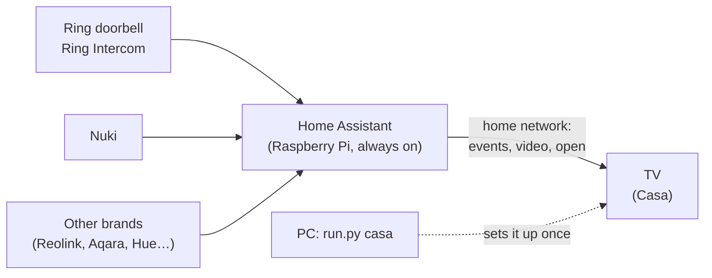

# Home Assistant: the doorbell, the gate, the door and the whole house on the TV

[Español](home-assistant.es.md) · [Back to the README](../../README.md) · [Smart Life without Home Assistant](home-automation.md)

The **Casa** add-on can take everything from [Home Assistant](https://www.home-assistant.io): any brand Home
Assistant knows reaches the TV without apps, accounts or voice assistants on the TV itself.

| | What it does |
|---|---|
| 🔔 **Doorbell** | Someone rings: a card with the live video comes up over whatever you are watching, with the visitor's sound. What was playing pauses, then carries on when you close the card. |
| 🏢 **Gate** | From the card, open the building's door (Ring Intercom, Nuki Opener, or any button or lock in Home Assistant). |
| 🔑 **Door** | From the card, open your own door (Nuki, or any lock in Home Assistant). |
| 🚶 **Motion** | Someone comes to the door: a small message at the top ("Someone is coming"), or the muted video if you prefer. |
| 💡 🌡️ 🚪 🔥 | The same home-screen row and alerts as with Smart Life (light, heater, temperature, humidity, door, gas), from any brand. |

> [!IMPORTANT]
> **Experimental.** Built and tested against a simulated Home Assistant and compiled for both tested TVs, but not yet
> tried with a real doorbell. If you try it, please [tell us how it went](../../CONTRIBUTING.md).



## What you need

1. **A Home Assistant server, always on.**
   - **Raspberry Pi 3 (1 GB): only to try it out.** Home Assistant no longer lists it: its install page asks for a
     Pi 4 or Pi 5 with at least 2 GB, and only the 64-bit image still exists (32-bit was dropped in 2026). It runs a
     few integrations; a camera's live video goes from Ring to the TV through it, so expect it to be slow.
   - **For every day:** a Raspberry Pi 4 or 5 with 2 GB or more, or a [Home Assistant Green](https://www.home-assistant.io/green/).
   - Use the official power supply (Pi 3: 5 V, 2.5 A), a good A2 microSD card or, better, a USB SSD, and an Ethernet
     cable. A Pi without a case works, but put a small heatsink on it and keep it off metal and carpets; a cheap case
     prevents short circuits.
2. **Your devices in Home Assistant** (Settings → Devices & services → Add integration):
   - **Ring** (doorbells, cameras, Ring Intercom): the [Ring integration](https://www.home-assistant.io/integrations/ring/).
     Sign in with your Ring account and its verification code. **End-to-end encryption must be off** in the Ring app,
     or nothing outside Ring can show the video. Live video needs no Ring Protect plan (the last recordings do).
     Home Assistant must be able to reach the internet on TCP port 5228 for rings to arrive at once.
   - **Ring Intercom**: it fits on the wires of the building's intercom (Ring's site has a compatibility checker). It
     opens the building's door only, and some intercoms only let it open after someone has rung.
   - **Nuki**: Smart Lock 3.0 Pro and 4th generation locks speak MQTT and Home Assistant finds them on its own (install
     the *Mosquitto broker* add-on and turn on MQTT in the Nuki app). Older locks need the Nuki Bridge and the
     [Nuki integration](https://www.home-assistant.io/integrations/nuki/). Matter over Thread also works, with a
     Thread radio. The **Nuki Opener** is Nuki's answer for building intercoms.
   - **Any other doorbell** works the same way when Home Assistant shows it as a doorbell event (Reolink, UniFi
     Protect, Aqara, Nest…): since 2026 every doorbell in Home Assistant sends the same `ring` event.
   - **Smart Life / Tuya** devices can come through Home Assistant's Tuya integration too, or keep Casa's own
     connection: both can live side by side.
3. **A TV with Tuned TV's launcher and Casa** (`run.py launcher`, see the [Android TV](android-tv.md) and
   [Fire TV](fire-tv.md) guides).
4. **The TV and Home Assistant on the same network** (or Home Assistant on `https://` with a public certificate,
   such as Nabu Casa's).

## Set it up

1. **Install Home Assistant** on the Pi: in [Raspberry Pi Imager](https://www.raspberrypi.com/software/), choose
   *Other specific-purpose OS → Home assistants and home automation → Home Assistant* and your Pi, write the card,
   start the Pi with the Ethernet cable, and open `http://homeassistant.local:8123` a few minutes later.
2. **Add your devices** (above).
3. **Make a user for the TV**: Settings → People → Users → Add user, **without administrator rights**. Sign in as
   that user once, open its profile → Security → *Long-lived access tokens* → Create token, and copy it.
4. **On the computer**, from the repo:

   ```bash
   uv run run.py casa conectar        # English: run.py home connect
   ```

   It asks for the address (`http://<home-assistant-ip>:8123`; the IP is safer than `homeassistant.local`, which some TVs cannot resolve) and the token (hidden as you type), checks them and saves
   both in `~/Documents/casa-tuya/ha.json` (another folder with `CASA_DIR`), outside the repo.
5. **Let it propose the roles:**

   ```bash
   uv run run.py casa descubrir       # run.py home discover
   ```

   It finds your doorbells (with their motion, camera and what opens them), the light, the heater, the sensors, the
   door and the gas, and prints what it chose. **Check `ha.json` before sending it**: remove what you don't want and
   look at what each doorbell opens.
6. **Send it to the TV** (ADB on, as for the launcher):

   ```bash
   TV_SERIAL=<tv ip>:5555 uv run run.py casa enviar      # run.py home send
   ```

   It answers `Casa has the configuration (2 doorbells); Home Assistant: connected`.
7. **Try the card:** `uv run run.py casa probar` (`home test`) shows the first doorbell's card as if someone had rung.
8. **Optional, a key to look at the door:** in your profile's `launcher/config.json`,

   ```json
   "app_keys": ["KEYCODE_PROG_BLUE:io.github.ignaciopd3.casa/.TimbreActivity"]
   ```

   Any free key works (on a TCL, the microphone key is free once the Assistant is off). It shows the first doorbell
   with a camera; the open buttons only appear if someone rang in the last few minutes.

### `ha.json`

```json
{
  "url": "http://<home-assistant-ip>:8123",
  "token": "…",
  "roles": {"luz": "light.living_room", "calefactor": "switch.heater", "temperatura": "sensor.living_room_temperature",
            "humedad": "sensor.living_room_humidity", "puerta": "binary_sensor.front_door", "gas": "binary_sensor.gas"},
  "timbres": [
    {"nombre": "Front door", "llamada": "event.front_door_ding", "movimiento": "event.front_door_motion",
     "camara": "camera.front_door_live_view", "abrir": ["lock.front_door"]},
    {"nombre": "Gate", "llamada": "event.intercom_ding", "abrir": ["button.intercom_open_door"]}
  ],
  "aviso_movimiento": "aviso",
  "abrir_tras_llamada_s": 180,
  "pausar": true
}
```

| Key | What it is |
|---|---|
| `roles` | `luz` and `calefactor`: a `light`, `switch`, `fan` or `input_boolean`. `temperatura`, `humedad`: a `sensor`. `puerta`, `gas`: a `binary_sensor`. All optional. |
| `timbres` | Up to 4 doorbells. `nombre` is what the card says; `llamada` is the doorbell's event (required); `movimiento` an event or a motion `binary_sensor`; `camara` a camera with live video; `abrir` up to 3 `button` (pressed) or `lock` (unlatched if it can, otherwise unlocked). The card names them *Open the gate* (a `button`, such as Ring Intercom's, or one whose id or name says gate, intercom, opener, portal, portero or telefonillo, such as a Nuki Opener) or *Open the door* (the rest); two of the same kind go by their Home Assistant names. |
| `aviso_movimiento` | `aviso` (small message, the default), `video` (the muted card for 20 s, never over a playing video) or `no`. |
| `abrir_tras_llamada_s` | How long after a ring the card may open (30 to 600 s, 180 by default). |
| `pausar` | Pause what was playing while the card shows (`true` by default). |

The keys are in Spanish, like the rest of Casa's settings.

## The doorbell card

| On the remote | What it does |
|---|---|
| ▲ ▼ (or ◀ ▶) | Move between the buttons |
| **OK held 1.5 s** | Open: a green ring fills around the button; letting go earlier does nothing. The button then says *Opened* or *Didn't open*. |
| OK on *Close*, or Back | Close the card |

The card closes by itself 90 seconds after the last ring or key press. While it shows, the remote works the card,
not the app underneath. It is a column down the right third of the screen: the video, the buttons in a list and the
hint at the bottom. It was chosen from three shapes in a [mockup](https://claude.ai/artifact/GP9bgvq1UGGJRu6Bw13XPV);
the shape lives only in `TimbreCard.java`.

## Try it without a doorbell

Useful to help develop it:

- **A video:** add a *Generic Camera* in Home Assistant with any RTSP or HTTP stream (an old phone with an IP-camera
  app works). Home Assistant's built-in go2rtc turns it into live video the card can show.
- **A real ring, without a doorbell:** with the Mosquitto broker add-on, publish this to the topic
  `homeassistant/event/test_doorbell/config` (Settings → Devices & services → MQTT → Configure → Publish a packet):

  ```json
  {"name": "Test doorbell", "unique_id": "test_doorbell", "device_class": "doorbell",
   "event_types": ["ring"], "state_topic": "test/doorbell"}
  ```

  Then each `{"event_type": "ring"}` published to `test/doorbell` is a ring for Home Assistant and for the TV
  (`event.test_doorbell` in `llamada`).
- **Something to open:** the *Demo* integration (`demo:` in `configuration.yaml`) brings locks, or make a template
  lock over an `input_boolean`.
- **Only the screen:** `run.py casa probar` shows the card with no event at all.

## Security

- **Opening needs a real ring** in the last few minutes, and OK held for 1.5 s. Without a ring there are no open
  buttons. A doorbell with no `abrir` opens nothing.
- **Home Assistant writes down every opening** in its logbook, with the TV's user.
- **The token** lives only in Casa's private storage on the TV (backups off) and in `ha.json` on your computer. It
  travels to the TV through `content write`'s standard input, never on a command line, and never reaches a log or the
  screen. Revoke it at any time in the TV user's profile.
- Home Assistant has no per-device permissions: a user without administrator rights can still use any device, so
  keep the token as you would a key.
- `http://` only on the home network; outside it, `https://` with a public certificate. Self-signed certificates
  are refused.
- Clean Your TV's *Smart Home* add-on never opens a door from a remote. Casa does, with the barriers above. If you
  don't want that, leave `abrir` out.

## Limits and what comes next

- **Talking from the TV** is not there yet: Home Assistant's two-way audio for Ring is still arriving, and TVs have no
  microphone of their own. Answer from the Ring app on your phone while you look at the TV.
- **Ring Alarm** is not in Home Assistant's Ring integration (the *ring-mqtt* add-on brings it); Casa does not show it yet.
- **TV in standby:** no card. Turning the TV on when someone rings (HDMI-CEC) may come later.
- **Live TV** from the tuner cannot be paused; the card still tries the video next to it. On a TV whose video decoder
  cannot play two videos at once, the card's picture may stay black; the buttons keep working.
- **Size:** libwebrtc adds 7 MB (32-bit) or 12 MB (64-bit) to Casa, and memory only while a card shows (it runs in
  its own process, which ends with the card).

## Help wanted

Test reports with real doorbells (brand, model, Home Assistant version, TV, what worked), translations of Casa's
texts, and other shapes for the card. See [CONTRIBUTING.md](../../CONTRIBUTING.md).
